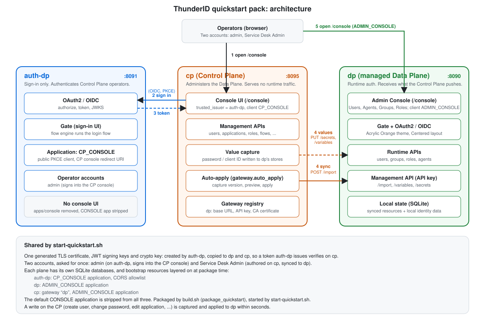
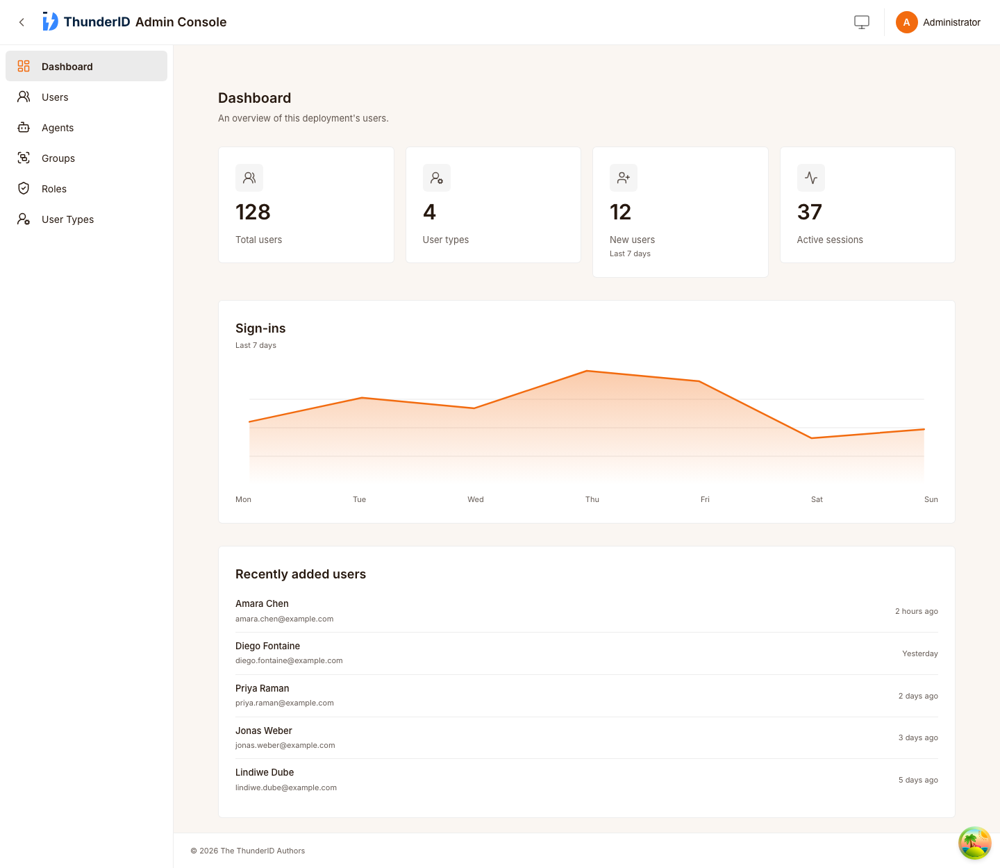
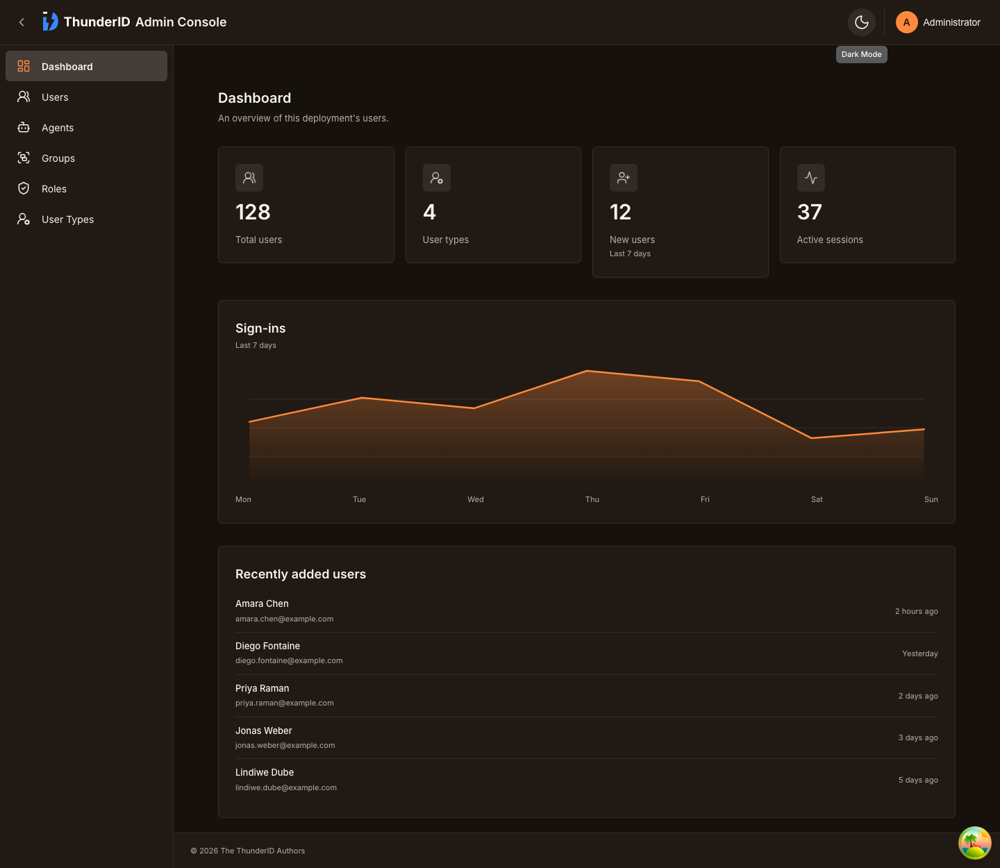
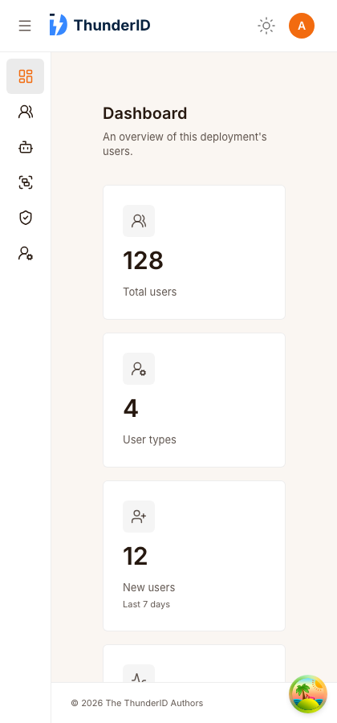

# Quickstart pack: build and run

The quickstart pack runs three ThunderID deployments already wired together:

| Deployment | Port | Role |
|---|---|---|
| **auth-dp** | 8091 | A Data Plane whose only job is signing operators into the Control Plane console. It carries one application, `CP_CONSOLE`, and serves no console UI. |
| **dp** (managed Data Plane) | 8090 | The Data Plane the Control Plane administers. Its own console is the **Admin Console** (Users, User Types), registered as the `ADMIN_CONSOLE` application. |
| **cp** (Control Plane) | 8095 | The Control Plane console. Applications, connections, roles, flows and users written here are captured and applied to dp automatically (`gateway.auto_apply`, on for this pack only). |

There are two accounts, asked for once at start: **admin** (default username `admin`), created on auth-dp and used to sign into the Control Plane console, and **Service Desk Admin** (default username `servicedeskadmin`), authored on the Control Plane and synced to the managed Data Plane, where it signs into the Admin Console.

## Architecture



How the numbered arrows work:

1. An operator opens the Control Plane console at `https://localhost:8095/console`.
2. The console has no login of its own. It redirects to auth-dp for an OIDC sign-in (PKCE, client `CP_CONSOLE`).
3. auth-dp returns a token for the Control Plane's own URL (the `resource` the console asks for). auth-dp's System resource server is registered under that URL at package time, and the Control Plane accepts the token because it shares auth-dp's signing keys and claims auth-dp's issuer.
4. A write on the Control Plane (a user, a password change, an application) is synced to the Data Plane. The credential value is first written to dp's secret and variable stores, then a configuration version is captured and imported through dp's management API, authenticated with the gateway's API key.
5. An operator opens the Data Plane Admin Console at `https://localhost:8090/console` and signs in on dp's own Gate (client `ADMIN_CONSOLE`).

The diagram source is [diagrams/quickstart-architecture.svg](diagrams/quickstart-architecture.svg).

## Prerequisites

- Go (version from `backend/go.mod`), Node.js and pnpm (the build installs pnpm if it is missing)
- `zip`, `curl`, `openssl` and `lsof` on the PATH
- macOS or Linux. The Windows quickstart scripts are not packaged yet.

## Build

Run from the repository root.

```bash
# 1. Build the frontend apps (gate, console, console-cp, admin-console)
./build.sh build_frontend

# 2. Build both backends and package the pack
./build.sh build_quickstart
```

`build_quickstart` does not build the frontend, so step 1 must come first. Skip it only if `frontend/apps/*/dist` is already up to date.

To rebuild after a code change, repeat the step that covers it. After a frontend-only change, run step 1 and then `./build.sh package_quickstart`, which repackages without rebuilding the Go binaries. That only works once `build_quickstart` has built them before; on a clean tree run `build_quickstart`. `make build_quickstart` does the same as the second command.

The result is `target/dist/thunderid-quickstart-<version>-<os>-<arch>.zip`.

### What packaging does

`package_quickstart` in [build.sh](../build.sh) assembles `auth-dp/`, `dp/` and `cp/` from the normal Data Plane and Control Plane packages, then:

- layers the bootstrap resources under [bootstrap/](bootstrap) onto each plane (see below)
- strips the default `CONSOLE` application from every plane's bootstrap, since none of them use it
- removes auth-dp's console UI
- ships `console-cp` (the console that runs every operation as a direct API call) as the Control Plane's console, and points it at auth-dp as its trusted issuer, with client `CP_CONSOLE`
- registers auth-dp's System resource server under the Control Plane's URL, because the console asks auth-dp for a token for that URL
- points the managed dp's admin console at client `ADMIN_CONSOLE`
- turns the default admin into the Service Desk Admin on dp and cp, with its own group and role under separate IDs, and leaves auth-dp's default `admin` as it is
- sets auth-dp to port 8091, and gives dp the quickstart management key hash
- turns on `gateway.auto_apply` and `gateway.allow_private_addresses` in the Control Plane's `deployment.yaml`; the second lets it reach dp on `localhost`, which it refuses by default
- adds [bootstrap.sh](bootstrap.sh) as `quickstart-bootstrap.sh` next to `start-quickstart.sh`

### Bootstrap resources

| Directory | Layered onto | Contents |
|---|---|---|
| [bootstrap/auth-dp](bootstrap/auth-dp) | auth-dp | CORS allowlist for the CP console origin; the `CP_CONSOLE` application |
| [bootstrap/dp-cp](bootstrap/dp-cp) | dp and cp | The `ADMIN_CONSOLE` application, same fixed ID on both so the Control Plane's copy replaces dp's on sync. Its sign-in page uses the bootstrap's "Acrylic Orange" theme and "Centered" layout (`themeId` and `layoutId`). |
| [bootstrap/cp](bootstrap/cp) | cp | Registers dp as a gateway (`00-` prefix so it exists before other resources are written) |

[bootstrap.sh](bootstrap.sh) holds what these templates need from the environment: the console URLs, the dp certificate, and the values seeded on dp so auto-apply is not blocked (see Run).

## Run

```bash
cd target/dist
unzip thunderid-quickstart-*.zip
cd thunderid-quickstart-*
./start-quickstart.sh
```

First run, in order:

1. Prompts for the two accounts' usernames and passwords (a generated password is offered for each): `admin` (default username `admin`) and Service Desk Admin (default `servicedeskadmin`). Set `ADMIN_USERNAME` and `ADMIN_PASSWORD` for the first, and `SERVICE_DESK_USERNAME` and `SERVICE_DESK_PASSWORD` for the second, to skip the prompts, for example in CI. With nothing supplied and no terminal, passwords are generated and printed at the end.
2. Sets up auth-dp, shares its certificate and signing keys with dp and cp, then sets up dp and cp.
3. Starts all three, then seeds the values dp has to hold before the first sync: the Admin Console's client ID and redirect URIs, the System resource server's identifier, and the Service Desk Admin's password secret. The Control Plane's bootstrap runs before dp is up, so it cannot hand these over itself.

Later runs skip what already exists and just start the three. Press Ctrl+C to stop all three.

## URLs

| What | URL |
|---|---|
| Control Plane console | https://localhost:8095/console |
| Data Plane Admin Console | https://localhost:8090/console |
| Data Plane Gate (login) | https://localhost:8090/gate |
| auth-dp Gate (login) | https://localhost:8091/gate |

All three use one self-signed certificate, so accept the browser warning once. Sign in to the Control Plane console with `admin`, and to the Data Plane Admin Console with the Service Desk Admin.

## Screenshots

The Data Plane Admin Console dashboard, in the orange theme. The numbers, the sign-in chart and the recently added users are placeholder values for now; they are not read from the server.

| Light | Dark |
|---|---|
|  |  |

On a phone-width screen the sidebar collapses to icons and the tiles stack in one column:



## Checking that sync works

1. Sign in to the Control Plane console with `admin`, and create or change something, for example a user under Users, Add User (pick a user type, then click an organization unit; the button stays disabled until one is chosen).
2. Wait a few seconds. A change is captured about two seconds after the last write, then applied.
3. Open the Data Plane Admin Console with the Service Desk Admin. The new user is listed under Users, and can sign in with the password set on the Control Plane.
4. Change that user's password on the Control Plane. After a few seconds only the new password works on dp.

On the Control Plane, `GET /configuration-versions` lists captured versions and `GET /gateways/{id}/applied-version` shows what dp holds. The Control Plane's log says `Applied a configuration version to a gateway` for each sync.

## Starting over

The three deployments keep their state in their own SQLite databases and key material. To reset, stop the pack and delete the unzipped folder, then unzip again. Do this after rebuilding the pack, because bootstrap resources only apply on a fresh database; a stale one keeps old applications such as `CONSOLE`.

## Troubleshooting

| Symptom | Cause |
|---|---|
| `environment variable ... is not set` during setup | Running an old `start-quickstart.sh` against a newly built pack, or the reverse. Rebuild and unzip fresh. |
| `port already in use` | Another process holds 8090, 8091 or 8095. The script clears them at start, but a process from another user may remain. |
| The Control Plane logs `Failed to apply the latest version to the default gateway` with code `GTW-1017` | dp lacks a value the version refers to. A dry run names it: `POST /gateways/{id}/apply` with `{"version":"latest","dryRun":true}`, then read `missing`. Seeded values live in `seed_dp_values` in [bootstrap.sh](bootstrap.sh); a new one is usually a new upstream reference that needs seeding there. |
| Nothing is logged after a change on the Control Plane | Auto-apply is off. Check that the Control Plane's `deployment.yaml` has `gateway.auto_apply: true`. |
| Signing into the CP console fails with `invalid_target` | auth-dp has no resource server for the Control Plane's URL. The pack registers it at package time, so rebuild and unzip fresh. |
| Signing into the CP console is rejected on the redirect | The Control Plane's URL is not a redirect URI of `CP_CONSOLE` on auth-dp. Check `CP_CONSOLE_URL` and start with fresh databases. |

## Local development without packaging

`./build.sh run` starts one backend with the gate, console and admin-console dev servers (ports 5190, 5191 and 5192). It does not start the Control Plane or the sync, so use the packaged pack to test anything that crosses planes.
